# gitlume

A calm, minimal terminal UI for git.

gitlume shows what changed, lets you stage, discard and commit it, browse
the history with a graph of every branch, and switch branches. No
boxes, no clutter: one accent color, generous spacing, and keybindings you
can discover with `?`.



## Install

```sh
go install github.com/skinleak/gitlume/cmd/gitlume@latest
```

You need Go 1.27 or newer to build it, and `git` on your `PATH` to run it.

## Usage

Run `gitlume` anywhere inside a git work tree.

| Key              | Action                                |
| ---------------- | ------------------------------------- |
| `j` / `k`, `↓` `↑` | Move through files or commits (or scroll the diff) |
| `tab`            | Switch focus between files and diff   |
| `ctrl+d` / `ctrl+u` | Scroll the diff by half a page      |
| `enter`          | View the selected diff or commit fullscreen (`esc` to go back) |
| `space`          | Stage or unstage the selected file    |
| `a`              | Stage everything                      |
| `d`              | Discard all changes to the selected file (asks first) |
| `D`              | Discard all uncommitted changes, including untracked files (asks first) |
| `c`              | Commit (`enter` to confirm, `esc` to cancel) |
| `1` / `2`        | Switch between files and the log: a graph of all branches next to the selected commit's files and diff |
| `←` / `→`        | Previous / next tab (wraps around)    |
| `b`              | Open the branch list, from files or the log (`esc` to go back) |
| `enter` (branches) | Check out the selected branch and go back (a remote branch gets a local tracking branch) |
| `r`              | Refresh                               |
| `?`              | Show all keybindings (`j`/`k` scroll them in a small window) |
| `q`              | Quit                                  |

Status refreshes after every action, whenever the terminal window regains
focus, and in the background every few seconds (less often in big
repositories), so it stays current even in a split or on a second screen.

## Design

- **Real git, not a reimplementation.** gitlume runs the `git` binary and
  parses its stable porcelain formats. Your config, hooks, and credentials
  behave exactly as they do on the command line.
- **Never blocks.** Every git command runs in the background. Results that
  arrive out of order are dropped and their git processes stopped, so fast
  navigation never shows the wrong diff or piles up work.
- **Never fights you for the lock.** Background refreshes use
  `GIT_OPTIONAL_LOCKS=0`, and write operations run one at a time.
- **Stays fast in big repos.** Diffs are capped at 1 MiB and only the
  visible lines are rendered. A keypress and a full frame take about
  0.2 ms even with 50,000 changed files. Background checks pace themselves
  by how long `git status` takes, so they never cost more than ~2% of a
  core.
- **Safe with odd file names and contents.** Paths are passed literally (a
  file named `*.txt` is just that file), and control characters can't reach
  your terminal.
- **Never crashes on a git error.** Failures show up in the status line.

## Development

```sh
go build ./...        # build
go test ./...         # unit + integration tests (needs git)
go vet ./...
go run ./cmd/gitlume  # run against the current repository
go run ./tools/preview  # regenerate docs/preview.svg after UI changes
```

```
cmd/gitlume/          entry point
internal/git/         git CLI wrapper and porcelain parsers (no UI)
internal/ui/          Bubble Tea models: root app, file list, diff, commit prompt, help
internal/ui/theme/    every color and style
internal/ui/keys/     every keybinding (help is generated from these)
tools/preview/        records the README clip from the real UI
```

## Roadmap

Done: status, diff, stage, discard, commit, the branch list, and the log
with its graph of all branches.
